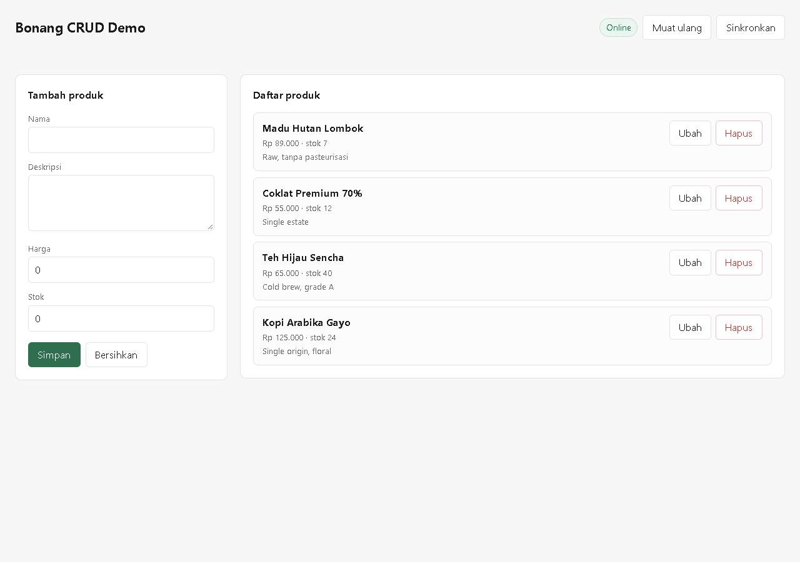

# Bonang

**Browser Optimized Network And Native Graphics** — bahasa pemrograman
full-stack untuk web, dengan satu bahasa untuk backend, frontend, dan
lapisan offline-first.

```
$ node cli/cli.js init my-app
$ cd my-app
$ node ../cli/cli.js dev
```

---

## Status

Rilis **0.1.0** (2026-11-11). Lengkap dan terverifikasi.

| Metrik | Nilai |
| --- | --- |
| Test | 356 lulus, 0 gagal, 0 dilewati |
| Bug | 48 tercatat, 48 Fixed, 0 Open |
| Batasan terverifikasi | 24 |
| Audit statis | 0 temuan pada kode referensi |
| Audit struktur | 0 siklus dependensi, 0 dead code, 0 duplikasi |
| Dependensi eksternal | **0** |

Rincian: [`docs/PROJECT_PROGRESS.md`](docs/PROJECT_PROGRESS.md),
[`docs/TEST_REPORT.md`](docs/TEST_REPORT.md),
[`docs/AUDIT_REPORT.md`](docs/AUDIT_REPORT.md).

---

## Apa Itu Bonang

Bonang adalah bahasa pemrograman yang dikompilasi ke JavaScript dan
dijalankan di V8. Bukan dokumentasi, bukan pseudocode — ada compiler,
runtime, standard library, package manager, CLI, dan aplikasi contoh yang
benar-benar berjalan.

**Yang bisa dilakukan:**

- Menulis backend HTTP dengan routing, middleware, dan validasi.
- Menulis frontend dengan runtime DOM, IndexedDB, dan service worker.
- Bekerja offline dengan antrean sinkronisasi dan resolusi konflik.
- Menyimpan data di SQLite dengan prepared statement dan query builder.
- Membangun, meng-lint, meng-audit, meng-benchmark, dan memigrasikan
  semuanya dari satu CLI.
- Melayani HTTP dengan header keamanan bawaan (CSP, `nosniff`,
  `X-Frame-Options`, `Referrer-Policy`, `Permissions-Policy`) yang dapat
  ditimpa per-route.
- Menghapus data dengan soft delete yang bisa dipulihkan, dan berpindah
  halaman dengan keyset pagination yang tidak melompati baris.
- Menyusun modul yang saling mengimpor, dan memuat modul saat runtime
  dengan dynamic `import()`.

**Yang belum ada (jujur):** type checker statis, ORM dengan schema diff,
enkripsi at-rest, dan laporan coverage. Daftar lengkap 24 batasan:
[`docs/KNOWN_LIMITATIONS.md`](docs/KNOWN_LIMITATIONS.md).

---

## Bahasa Dasarnya Apa?

Bonang **bukan** PHP dan **bukan** JavaScript. Ini bahasa pemrograman
tersendiri dengan sintaks, grammar, dan semantik sendiri — yang punya
compiler sendiri, parser sendiri, dan runtime sendiri.

Yang terjadi di balik layar:

```
Kode Bonang (.bng)
      │
      ▼
Lexer → Parser (Pratt) → AST → Codegen ──► JavaScript (CommonJS) ──► V8
```

| Bagian | Bahasa | Penjelasan |
| --- | --- | --- |
| **Source** | **Bonang** | `.bng`. Sintaks sendiri: `fn` untuk fungsi, `let`/`const` untuk variabel, `class` dengan `interface`/`enum`, tipe opsional. Grammar formal ada di [`docs/GRAMMAR.md`](docs/GRAMMAR.md). |
| **Backend (BE)** | Bonang → **JavaScript (Node.js)** | Server dikompilasi ke JavaScript CommonJS, lalu berjalan di Node.js. Semua API Node (`node:http`, `node:sqlite`, `node:crypto`) tersedia apa adanya. |
| **Frontend (FE)** | Bonang → **JavaScript (browser)** | Client dikompilasi ke JavaScript browser-murni (IIFE). Tidak ada `require`, tidak ada modul Node — modul Node yang tidak boleh dipakai di browser **ditolak saat build**. |

Jadi: **satu bahasa (Bonang) untuk BE dan FE**, yang dikompilasi ke
JavaScript. JavaScript adalah *target*, bukan bahasa aslinya — sama
seperti Java dikompilasi ke bytecode.

Contoh perbandingan — Bonang vs JavaScript equivalent-nya:

```bonang
// Bonang
export async fn main() {
    const app = createServer({ port: 3000 });
    app.router.get("/api/products/:id", async (ctx) => {
        const id = Number.parseInt(ctx.params.id, 10);
        return { id };
    });
    await app.listen(3000);
}
```

```javascript
// JavaScript yang dihasilkan compiler
async function main() {
    const app = createServer({ port: 3000 });
    app.router.get("/api/products/:id", async (ctx) => {
        const id = Number.parseInt(ctx.params.id, 10);
        return { id };
    });
    await app.listen(3000);
}
module.exports.main = main;
```

Bedanya ada pada **APA** yang ditulis programmer, bukan **ke mana**
dikompilasi. Bonang memberi tipe deklaratif, `class` dengan
`interface`/`enum`, validasi input bawaan, error bertingkat
(`ValidationError`, `NotFoundError`, `ConflictError`), dan API offline-first
— semuanya yang harus ditulis manual di JavaScript mentah.

---

## Persyaratan

- **Node.js >= 22** (diuji pada v24.21.0). Memakai `node:sqlite` langsung.
- **Tanpa dependensi eksternal.** `dependencies: {}` dan
  `devDependencies: {}`. Yang dibutuhkan hanya runtime Node.

---

## Instalasi

### Opsi 1 — Pasang CLI secara global (disarankan)

```bash
git clone https://github.com/<user>/bonang-lang.git
cd bonang-lang
npm install -g .

bonang version
# Bonang v0.1.0
# Node v24.21.0 | win32 x64
```

`npm install -g .` tidak mengunduh apa pun dari registry — proyek ini
nol dependensi, jadi yang terpasang hanya symlink ke `cli/cli.js`.

### Opsi 2 — Tanpa instalasi

```bash
git clone https://github.com/<user>/bonang-lang.git
cd bonang-lang
node cli/cli.js <perintah>
```

### Opsi 3 — Pakai dari proyek sendiri

```bash
npm install --save-dev bonang-lang
npx bonang init my-app
```

### Membuat proyek baru

```bash
bonang init my-app
cd my-app

#isi file .bng di src/server/main.bng
bonang dev        # dev server + hot reload
bonang build      # bundle ke dist/
bonang test       # jalankan test suite Bonang
```

Struktur proyek yang dihasilkan:

```
my-app/
├── bonang.config.json
├── src/
│   ├── server/main.bng      # entry backend
│   ├── client/main.bng      # entry frontend (opsional)
│   └── shared/              # modul dipakai server + client
├── public/                  # aset statis (HTML, CSS, service worker)
├── tests/app.test.bng       # test ditulis dalam Bonang
└── dist/                    # hasil build (dibuat otomatis)
```

### Deploy ke hosting

Yang di-upload **hanya** `dist/` — bukan `src/`, bukan `compiler/`,
bukan `cli/`. Folder `dist/` sudah mandiri: isinya JavaScript murni plus
`node:*` built-in, tanpa `node_modules`.

```bash
bonang build
# upload dist/ + file database ke hosting
node dist/server.js
```

Butuh hosting yang mendukung **Node.js** (VPS, Railway, Render, Fly.io).
Shared hosting PHP biasa tidak bisa menjalankan Bonang.

---

---

## CLI

| Perintah | Fungsi |
| --- | --- |
| `bonang init <dir>` | Membuat proyek Bonang baru |
| `bonang run <entry>` | Kompilasi lalu jalankan |
| `bonang build` | Bundel server + client ke `dist/` + `precache-manifest.json` |
| `bonang dev` | Dev server dengan hot reload (SSE) |
| `bonang test` | Menjalankan test suite Bonang |
| `bonang lint` | 9 aturan analisis statis |
| `bonang audit` | 8 pemeriksaan keamanan (4 berbasis AST) |
| `bonang audit --structure` | Audit struktur: siklus dependensi, dead code, duplikasi |
| `bonang bench` | 5 skenario benchmark |
| `bonang migrate` | Menjalankan migrasi database |
| `bonang version` | Versi bahasa |

Semuanya berfungsi — bukan placeholder.

---

## Contoh Kode

```bonang
import { createServer, createPool, ValidationError, NotFoundError } from "bonang";

export async fn main() {
    const pool = createPool({ filename: "./data/app.db" });
    const app = createServer({ port: 3000 });

    app.router.get("/api/products/:id", async (ctx) => {
        const id = Number.parseInt(ctx.params.id, 10);
        if (!Number.isInteger(id)) {
            throw new ValidationError("id harus angka bulat");
        }
        const product = await pool.queryOne(
            "SELECT * FROM products WHERE id = ?",
            [id]
        );
        if (!product) throw new NotFoundError(`Produk ${id} tidak ditemukan`);
        return { status: "success", data: product };
    });

    await app.listen(3000);
    return app;
}
```

Nilai selalu lewat placeholder positional `?`. Nama kolom/tabel yang
tidak bisa diparameterkan divalidasi terhadap allowlist identifier.

> Top-level `await` belum didukung — gunakan `async fn main()`.

---

## Aplikasi Demo



`apps/bonang-crud-demo` — aplikasi CRUD penuh yang ditulis dalam Bonang:
model `Product`, `ProductRepository`, `ProductService`,
`ProductController`, SQLite `bonang_demo`, migrasi, frontend, service
worker, IndexedDB + sync queue, dan resolusi konflik.

```bash
cd apps/bonang-crud-demo
node ../../cli/cli.js build
node dist/server.js
```

| Route | Metode | Fungsi |
| --- | --- | --- |
| `/api/info` | GET | Metadata aplikasi |
| `/api/health` | GET | Health check |
| `/api/products` | GET | Daftar + paginasi |
| `/api/products/summary` | GET | Agregasi inventaris |
| `/api/products/:id` | GET | Detail satu produk |
| `/api/products` | POST | Buat produk |
| `/api/products/:id` | PUT | Update (dukungan `baseVersion`) |
| `/api/products/:id` | DELETE | Hapus produk |
| `/api/sync` | POST | Sinkronisasi antrean offline |

Konflik versi ditangani dengan optimistic concurrency: client mengirim
`baseVersion`, server menolak dengan **409 CONFLICT** dan mengembalikan
data server di `details.server`.

---

## Struktur Proyek

```
compiler/      lexer, parser, AST, codegen, bundler
runtime/       core, async, http, database, security, filesystem, client
standard-library/
package-manager/
cli/           cli, linter, auditor, structure-audit, dev-server, migrate
apps/          bonang-crud-demo
examples/
tests/         unit, integration, regression, offline, concurrency,
               database, security, tools
benchmarks/    benchmark.js, RESULTS.md
docs/          19 dokumen desain dan status
```

---

## Menjalankan Test

```bash
npm test               # 356 test, semua suite
node --test "tests/unit/*.test.js"
node --test "tests/security/*.test.js"
node --test "tests/tools/bundler.test.js"
```

Tidak ada test yang dinonaktifkan, dilewati, atau di-`todo`.

CI berjalan otomatis di GitHub Actions untuk Node 22 dan 24 — setiap PR
harus melewati seluruh suite, lint, audit, dan build demo sebelum bisa
di-merge.

---

## Berkontribusi

Kontribusi diterima — dari memperbaiki typo sampai menambah fitur baru di
compiler. Detail lengkap ada di
[`CONTRIBUTING.md`](CONTRIBUTING.md).

Ringkasnya:

```bash
git clone https://github.com/<user>/bonang-lang.git
cd bonang-lang
npm test                      # pastikan baseline hijau

git checkout -b feat/nama-fitur
# ... tulis kode + test ...

npm test && node cli/cli.js lint && node cli/cli.js audit --structure
git commit -m "feat(scope): deskripsi singkat"
git push && buka Pull Request
```

Empat aturan yang tidak bisa dilanggar:

1. Tidak boleh ada implementasi palsu (stub, mock, nilai hardcoded).
2. Tidak boleh ada test yang dinonaktifkan, dilewati, atau di-`todo`.
3. Tidak boleh ada klaim fitur selesai sebelum diuji.
4. Tidak boleh ada exception yang disembunyikan.

Tiap bug yang diperbaiki harus punya regression test, dan tiap bug baru
dicatat di [`docs/BUG_TRACKER.md`](docs/BUG_TRACKER.md) dengan tanggal,
komponen, severity, root cause, fix, dan regression test.

---

## Performa

Diukur pada Windows 11 / Node v24.21.0, satu mesin:

| Skenario | Throughput |
| --- | --- |
| Kompilasi | 6 081 batch/detik |
| Eksekusi Bonang | 2 941 176 op/detik |
| Eksekusi Node.js | 2 403 846 op/detik |
| Eksekusi PHP 8.2 | 293 083 op/detik |
| HTTP p99 @ 1000 request | 471,86 ms |

Angka di atas adalah snapshot satu eksekusi; benchmark pada mesin yang
sama berfluktuatasi nyata antar-jalankan (compile 4 932-8 486 batch/detik
pada empat eksekusi). Yang stabil: rasio Bonang vs Node selalu di atas
1,00 (rentang 1,05x-1,22x).

**Bonang berada pada paritas dengan JavaScript.** Klaim keunggulan performa
**tidak** dibuktikan — Bonang adalah transpiler ke JavaScript, jadi
advantage struktural tidak mungkin diharapkan. Yang terbukti: paritas
dengan Node, urutan magnitude di atas PHP, dan event loop yang tidak
diblokir I/O.

Metodologi lengkap: [`benchmarks/RESULTS.md`](benchmarks/RESULTS.md).

---

## Dokumentasi

| Dokumen | Isi |
| --- | --- |
| [LANGUAGE_SPECIFICATION.md](docs/LANGUAGE_SPECIFICATION.md) | Sintaks dan semantik |
| [GRAMMAR.md](docs/GRAMMAR.md) | Grammar formal |
| [ARCHITECTURE.md](docs/ARCHITECTURE.md) | Komponen dan aliran data |
| [COMPILER_DESIGN.md](docs/COMPILER_DESIGN.md) | Pipeline compiler |
| [RUNTIME_DESIGN.md](docs/RUNTIME_DESIGN.md) | Runtime dan concurrency |
| [SECURITY_DESIGN.md](docs/SECURITY_DESIGN.md) | Model keamanan |
| [DATABASE_DESIGN.md](docs/DATABASE_DESIGN.md) | Skema, pool, query builder |
| [OFFLINE_FIRST_DESIGN.md](docs/OFFLINE_FIRST_DESIGN.md) | Sync queue dan konflik |
| [PRD.md](docs/PRD.md) | Requirements |
| [TECHNICAL_DECISIONS.md](docs/TECHNICAL_DECISIONS.md) | Keputusan dan alasannya |
| [RISK_REGISTER.md](docs/RISK_REGISTER.md) | Risiko dan mitigasi |
| [BUG_TRACKER.md](docs/BUG_TRACKER.md) | 48 bug dan perbaikannya |
| [AUDIT_REPORT.md](docs/AUDIT_REPORT.md) | Hasil audit |
| [KNOWN_LIMITATIONS.md](docs/KNOWN_LIMITATIONS.md) | 24 batasan terverifikasi |
| [PROJECT_PROGRESS.md](docs/PROJECT_PROGRESS.md) | Status per fase |
| [TEST_REPORT.md](docs/TEST_REPORT.md) | Hasil pengujian |
| [CHANGELOG.md](docs/CHANGELOG.md) | Riwayat perubahan |
| [RELEASE_NOTES.md](docs/RELEASE_NOTES.md) | Ringkasan rilis |

---

## Lisensi

MIT — lihat [`LICENSE`](LICENSE).
